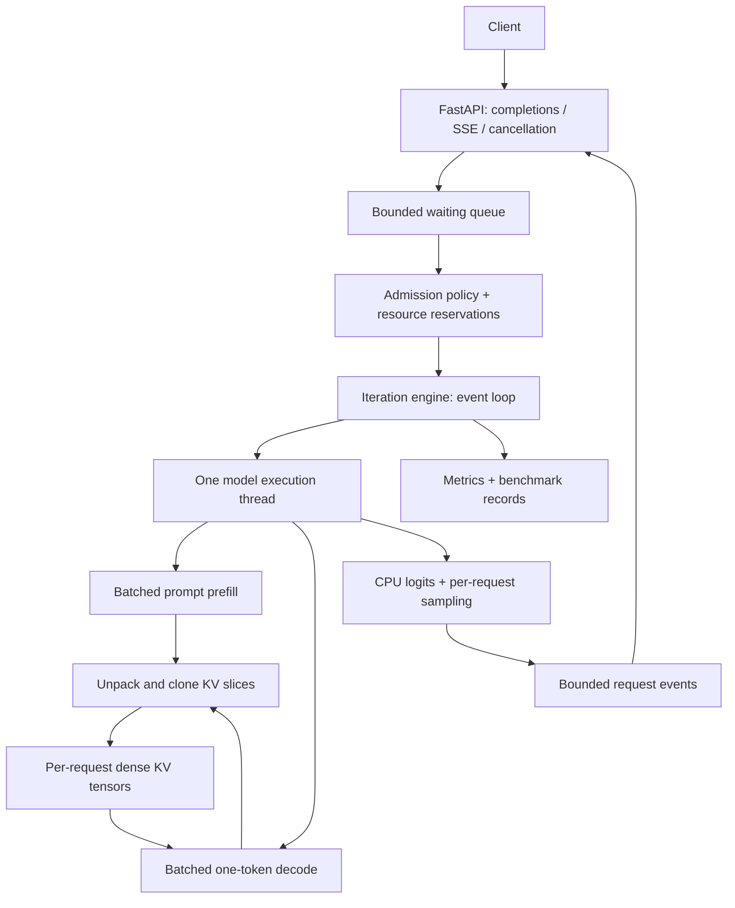
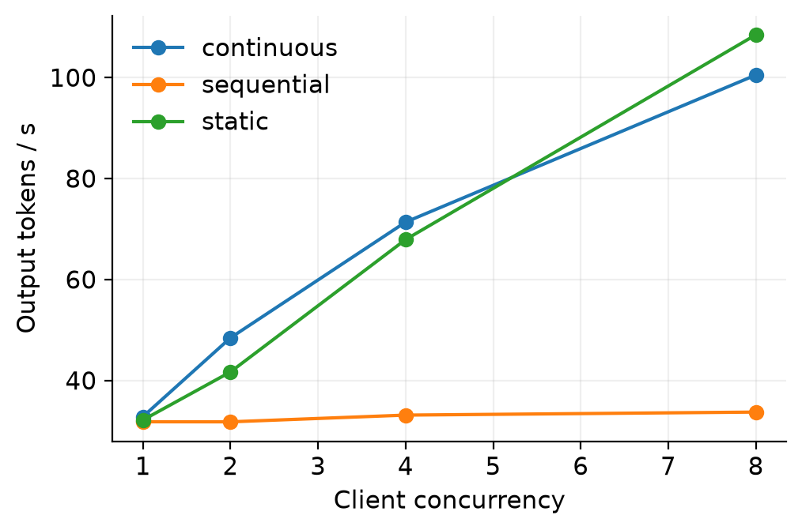

# AxiomServe

[](https://github.com/saidurpulok/axiomserve/actions/workflows/ci.yaml)

**An LLM serving runtime written from the ground up to see how scheduling,
batching and the KV cache trade latency against throughput on a single 8 GB
laptop GPU.** Hugging Face Transformers provides the Qwen2 model definition and
weights. AxiomServe owns everything around them: the generation loop, batched
prefill and decode, KV-cache handling, request scheduling, streaming and metrics.

The short version is that continuous batching cut p95 time-to-first-token from
503 ms to 119 ms at 8 concurrent requests, compared with static batching. Static
batching still had slightly higher throughput, so neither one wins outright.

## Why I built it

Production engines like vLLM are fast because of a handful of ideas: batched
prefill, KV caching, continuous batching and careful scheduling. Inside a large
codebase those ideas are hard to see. I wanted to build each moving part myself,
keep it small enough to read, and measure what each one actually buys on
hardware I own.

## What it does

- **Prefill and decode:** batched prompt prefill, then one-token-at-a-time
  decode that reuses the real KV tensors from earlier steps.
- **Three batching modes behind one engine:**
  - sequential, one request at a time
  - static, which gathers a cohort and runs it until every request finishes
  - continuous, which lets finished requests leave and new ones join between
    decode steps
- **Admission:** first-come-first-served or shortest-prompt-first, with bounded
  queues and reservations for context length, padded tokens and, optionally,
  estimated KV memory.
- **Sampling:** greedy, temperature, top-k and top-p, with per-request seeds,
  EOS handling and output limits.
- **Serving:** an HTTP completions API with SSE streaming, cancellation and
  graceful shutdown.
- **Measurement:** per-request timings, bounded metrics, seeded benchmark sweeps
  and plots generated from the saved results.

It supports full-attention Qwen2 models only, with `Qwen/Qwen2.5-0.5B-Instruct`
as the default.



Requests move through `WAITING → PREFILLING → RUNNING → FINISHED`, and can be
cancelled or fail from any state before the last. When a request finishes, its
cache and engine entries are released.

| Mode | Admission | Trade-off |
| --- | --- | --- |
| Sequential | One request at a time | Correctness baseline; everyone else waits |
| Static | Gathers a cohort over a short interval | Batched forwards, but finished requests hold their slot until the whole cohort is done |
| Continuous | Rechecks capacity between iterations | New requests prefill while older ones keep decoding; prefill briefly pauses decode |

## Results

The benchmark ran on an RTX 5070 Laptop GPU (8 GB) with Qwen2.5-0.5B-Instruct in
float16. Each case sent 16 requests in two bursts of eight, with prompts of 8–32
tokens and outputs of 8–24 tokens. All 192 requests across the 12 cases
succeeded.

At 8 concurrent requests:

| Mode | Tokens/s | TTFT p50 (ms) | TTFT p95 (ms) | Latency p95 (ms) |
| --- | ---: | ---: | ---: | ---: |
| Sequential | 33.7 | 2823 | 3478 | 4052 |
| Static | 108.5 | 57 | 503 | 1581 |
| Continuous | 100.5 | 62 | 119 | 1416 |



- **Batching tripled throughput.** It went from 33.7 tokens/s with sequential
  serving to 100–108 tokens/s with either batching mode.
- **Continuous batching kept the tail latency low.** Its p95 TTFT was 119 ms,
  against 503 ms for static batching, because new requests join between decode
  steps instead of waiting for a cohort to finish.
- **Static batching had slightly higher throughput** in this run, so this is a
  latency/throughput trade-off, not a universal win.
- **Moving the KV cache around is expensive.** At concurrency 8, preparing and
  splitting the cache took about 29–31% of batched runner time. That makes a
  paged KV cache the obvious next step.

This is one small run with short contexts and no confidence intervals. Peak
allocated GPU memory stayed near 1 GiB, so it doesn't test memory pressure.
The full table, all plots and caveats are in [RESULTS.md](RESULTS.md).

## Limitations

- Each request's KV cache is a dense tensor that gets padded, packed and copied
  on every decode step. There's no paged cache.
- Prefilling a new prompt blocks decode for active requests. There's no chunked
  prefill or preemption.
- There are no custom kernels, CUDA graphs, quantization, prefix caching or
  speculative decoding.
- It runs as one process on one GPU, behind a minimal completions API that isn't
  fully OpenAI-compatible.
- Shortest-prompt-first can starve long prompts.

More detail is in [LIMITATIONS.md](docs/LIMITATIONS.md).

## What I'd try next

- A paged KV cache, to remove the per-step repacking.
- Chunked prefill, so new prompts stop stalling decode.
- Larger sweeps with longer contexts, repeated runs with confidence intervals
  and randomized case order.
- Prefix caching for shared prompts.

## Run it

You need Python 3.11+ and [uv](https://docs.astral.sh/uv/). The first run
downloads the model weights. A CUDA GPU is optional: use `--device cpu` without
one, but expect it to be slower.

```bash
uv sync --python 3.12 --group dev --extra bench
uv run axiom serve --config configs/serve.yaml
```

Then send a request:

```bash
curl -N http://127.0.0.1:8000/v1/completions \
  -H 'Content-Type: application/json' \
  -d '{"prompt":"Explain a KV cache:","max_tokens":32,"temperature":0,"stream":true}'

curl http://127.0.0.1:8000/metrics
curl http://127.0.0.1:8000/health
curl -X DELETE http://127.0.0.1:8000/v1/requests/REQUEST_ID
```

- **Streaming** returns an `X-Request-ID` header, JSON `data:` chunks, a finish
  reason and `[DONE]`.
- **Errors:** a full queue returns 429, and a prompt or output that can't fit
  returns 422.
- **Prompts** are raw text, so apply the model's chat template yourself if you
  want chat behavior.
- **Processes:** run one server process. Each extra Uvicorn worker would load its
  own copy of the model.

On some systems, PyTorch's Triton helper needs Python development headers to
compile. If GPU runs fail on that, install a Python build that includes the
headers (for example with `uv python install 3.12`) and point `CPATH` at its
`include/python3.12` directory.

Benchmarks:

```bash
uv run axiom bench --config configs/bench.yaml --output results/benchmark.json
uv run python scripts/plot_benchmarks.py results/benchmark.json
```

The benchmark measures in-process serving and excludes model loading, warmup and
HTTP transport. Every mode gets the same seeded workload, and output lengths are
fixed by ignoring EOS so the modes are comparable. To compare scheduling
policies, change `runtime.scheduler`.

Checks:

```bash
uv run ruff check . && uv run ruff format --check . && uv run mypy src
uv run pytest -m 'not gpu and not pretrained'
uv run python scripts/smoke_test.py --device cuda
AXIOM_TEST_GPU=1 uv run pytest -m gpu
```

The CPU tests build a tiny randomly initialized Qwen2 model, so they need no
download. They check padded batched decode against full-sequence forwards, and
manual greedy decoding against Transformers' `generate()`, which is used only as
a test oracle.

## Repository layout

- `core/engine.py`: request lifecycle, queue, admission and the iteration loop
- `runtime/model_runner.py`: the prefill and decode forwards
- `runtime/cache.py`, `runtime/batching.py`: KV packing, padding and positions
- `core/sampling.py`, `core/scheduler.py`: decoding and admission policies
- `server/`: the HTTP API and streaming
- `metrics/`, `bench/`: measurement and benchmark sweeps
- `tests/`, `scripts/`: correctness tests, the smoke test and plotting
- [Architecture](docs/ARCHITECTURE.md), [design notes](docs/DESIGN.md) and
  [limitations](docs/LIMITATIONS.md)

## License

MIT
